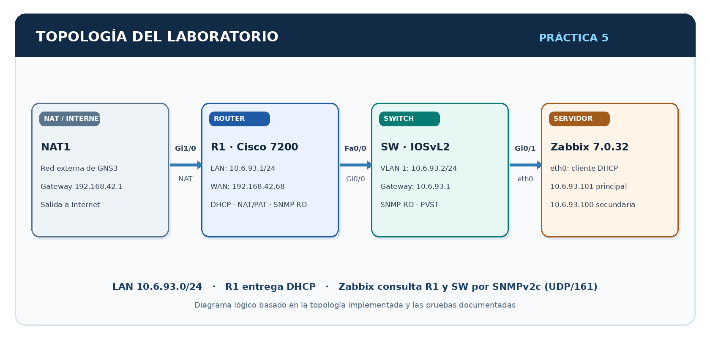
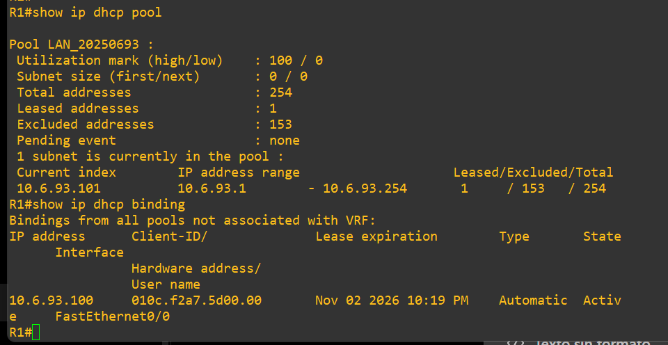
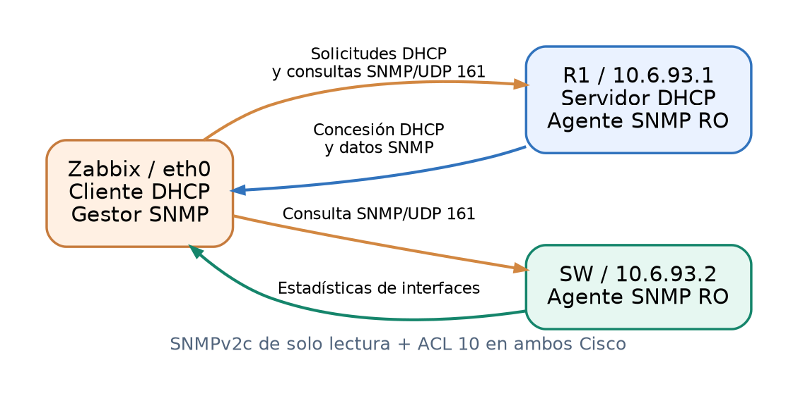
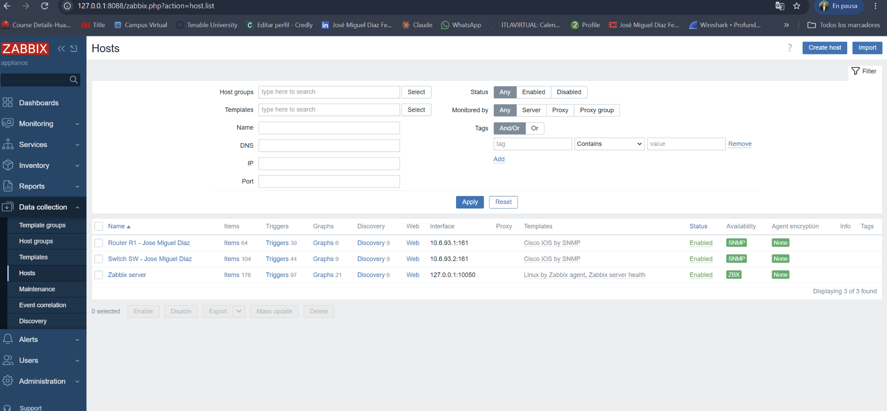
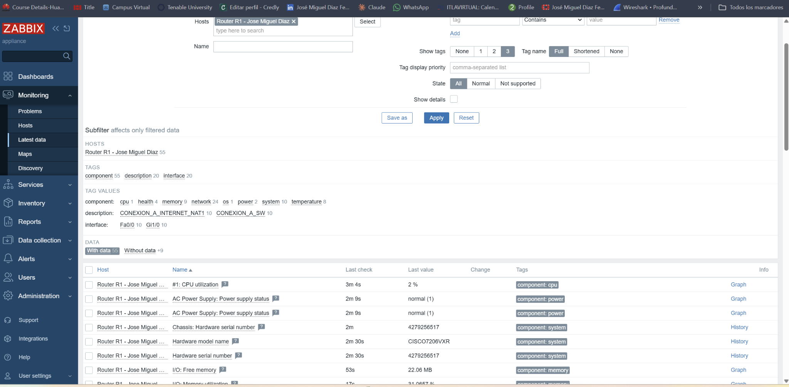
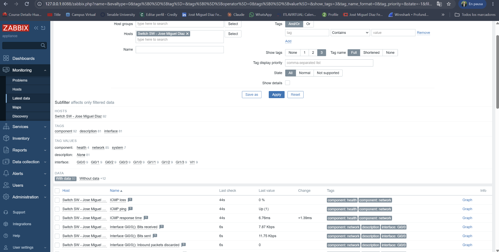

# Infraestructura 2 — Práctica 5: GNS3, DHCP, SNMP y Zabbix

**Estudiante:** José Miguel Díaz Ferreras  
**Matrícula:** `2025-0693`  
**Asignatura:** Seguridad de Redes  
**Entorno:** GNS3 · Cisco IOS · Zabbix Appliance 7.0.32

🎥 **Video de demostración:** [Ver en YouTube](https://youtu.be/7xHnanq7HHQ)

> Laboratorio académico de Infraestructura 2. Los archivos de configuración publicados no exponen la comunidad SNMP real ni contraseñas.

## Propósito

Demostrar en una topología funcional de **GNS3** el direccionamiento IPv4 de los equipos, la asignación automática de direcciones mediante **DHCP**, la configuración de comunidades **SNMP de solo lectura (RO)** y la consulta de datos reales del router y el switch desde **Zabbix**.

## Arquitectura

- **NAT1:** nodo de salida para el tráfico externo del laboratorio.
- **R1 (Cisco 7200):** puerta de enlace de la LAN (`10.6.93.1/24`), servidor DHCP, NAT/PAT y agente SNMP.
- **SW (Cisco IOSvL2):** conmutador de la LAN; SVI de administración en VLAN 1 (`10.6.93.2/24`) y agente SNMP.
- **Zabbix Appliance:** cliente DHCP conectado al switch y servidor de monitoreo SNMPv2c para ambos dispositivos.

**Topología implementada en GNS3:** [ver captura original](images/evidencias/01_topologia_real.png) · **Diagrama detallado:** [ver direcciones e interfaces](images/diagramas/topologia_logica.png)

## Direccionamiento IPv4

| Equipo / interfaz | Dirección observada | Uso |
|---|---|---|
| R1 — Fa0/0 | `10.6.93.1/24` | Gateway de la LAN y DHCP |
| R1 — Gi1/0 | `192.168.42.68/24` (DHCP) | NAT outside hacia NAT1 |
| SW — VLAN 1 | `10.6.93.2/24` | Administración SNMP |
| Zabbix — eth0 | `10.6.93.101/24` (principal) | Origen de las consultas SNMP |
| Zabbix — eth0 | `10.6.93.100/24` (secundaria) | Concesión DHCP y acceso web temporal |

> Ambas direcciones de Zabbix fueron observadas durante las pruebas; su coexistencia se documenta como una particularidad del laboratorio, no como configuración ideal de producción.

## Servicios implementados

### 1. DHCP en R1

El pool `LAN_20250693` administra la red `10.6.93.0/24`, usa `10.6.93.1` como puerta de enlace y asigna direcciones del rango **10.6.93.100 a 10.6.93.200**. Se verificó una concesión activa para `10.6.93.100`.

Zabbix utiliza `BOOTPROTO=dhcp` y `ONBOOT=yes` en su interfaz `eth0`. [Ver evidencia del cliente DHCP](images/evidencias/04_cliente_dhcp_zabbix.png).

### 2. SNMP de solo lectura

R1 y SW están configurados con **SNMPv2c, UDP/161 y permisos RO**. La **ACL 10** autoriza las direcciones específicas del servidor de monitoreo. No se publica el valor real de la comunidad.

### 3. Monitoreo de router y switch

Los dos equipos se registraron usando la plantilla **Cisco IOS by SNMP**. El estado **SNMP en verde** y las métricas obtenidas en *Monitoring → Latest data* demuestran que la consulta se completó correctamente.

**R1:** el monitoreo mostró el modelo `CISCO7206VXR`, uso de CPU y memoria.  

**SW:** se observaron las estadísticas de tráfico recibido y enviado en la interfaz `Gi0/0`.  

### 4. NAT/PAT y acceso de administración

R1 permitió la salida de la LAN mediante NAT/PAT. Para abrir el frontend de Zabbix desde Windows se documentó una redirección temporal de puerto y un túnel SSH. El acceso administrativo web no forma parte de la comunicación SNMP entre el servidor y los dispositivos.

## Seguridad y validación

- Comunidad SNMP limitada a **solo lectura (RO)** y protegida mediante ACL 10.
- Pruebas de DHCP, conectividad y métricas SNMP documentadas con capturas reales.
- Running-configs publicables con la comunidad SNMP sustituida por un marcador.
- El protocolo SNMPv2c no cifra consultas; se utilizó en una red académica aislada.
- Las dos direcciones DHCP y la redirección web temporal se describen en el informe técnico como limitaciones del montaje.

## Informe técnico

Los dos archivos modificados por el estudiante se incluyen **sin alterar su contenido**:

| Documento | Acceso |
|---|---|
| Informe técnico final en PDF | [Abrir PDF](docs/Documento_Tecnico_Zabbix_Jose_Miguel_Diaz.pdf) |
| Informe técnico editable en Word | [Abrir DOCX](docs/Documento_Tecnico_Zabbix_Jose_Miguel_Diaz.docx) |
| Documento técnico con imágenes en GitHub | [Ver Markdown](docs/DOCUMENTO_TECNICO.md) |
| Evidencias y pruebas | [Ver pruebas](docs/PRUEBAS_Y_EVIDENCIAS.md) |
| Resolución de incidencias | [Ver incidencias](docs/INCIDENCIAS_Y_SOLUCIONES.md) |
| Comprobación de requisitos | [Ver matriz](docs/MATRIZ_DE_REQUISITOS.md) |

## Archivos del repositorio

| Carpeta | Contenido |
|---|---|
| [`configs/`](configs/) | Running-configs publicables de R1 y SW; cliente DHCP de Zabbix |
| [`docs/`](docs/) | Documentos PDF, Word, explicaciones y evidencias |
| [`images/`](images/) | Capturas del laboratorio y diagramas PNG |
| [`scripts/`](scripts/) | Comandos IOS, diagnósticos Linux y túnel PowerShell |

## Resultado

Se verificó el funcionamiento de **DHCP para la LAN**, el **direccionamiento de R1 y SW**, la configuración **SNMP RO** y la recepción de **datos reales de ambos dispositivos en Zabbix**.
