# Informe técnico y evidencias del laboratorio

> **Versión principal:** los documentos PDF y Word de esta carpeta son los archivos editados por el estudiante. Este índice permite navegar por las evidencias directamente desde GitHub.

## Documentos finales

- 📄 **[Documento técnico final (PDF)](Documento_Tecnico_Zabbix_Jose_Miguel_Diaz.pdf)** — para lectura y entrega.
- 📝 **[Documento técnico final (Word)](Documento_Tecnico_Zabbix_Jose_Miguel_Diaz.docx)** — versión editable.
- [Volver al README principal](../README.md).

## Arquitectura y diagramas

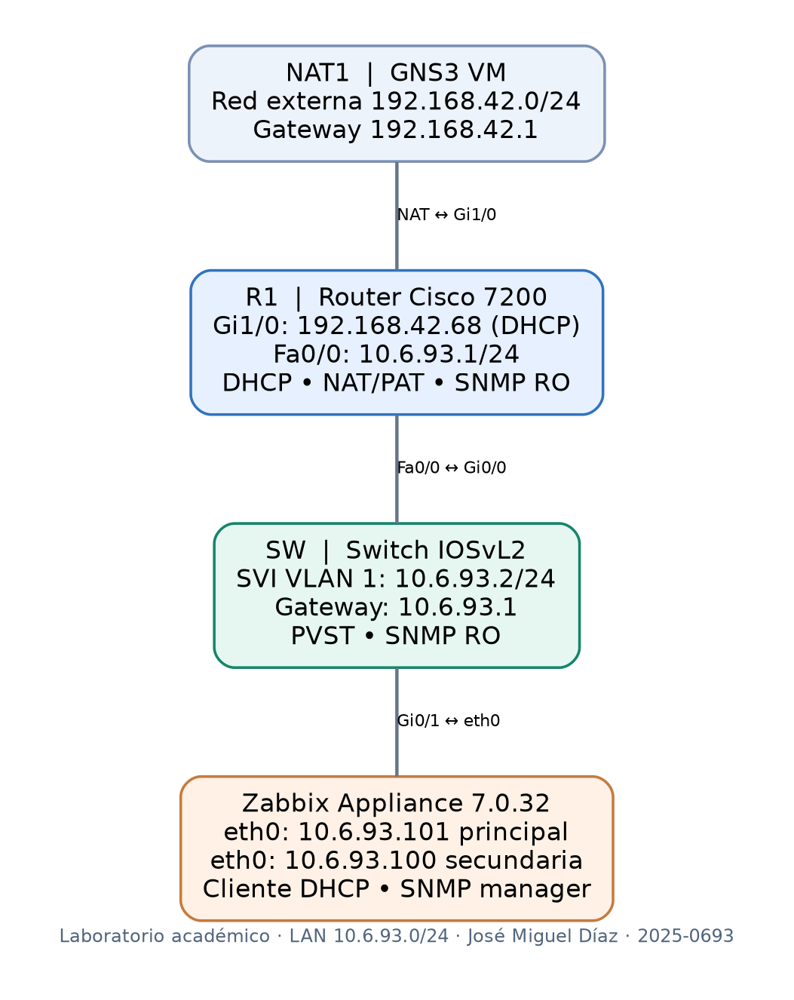

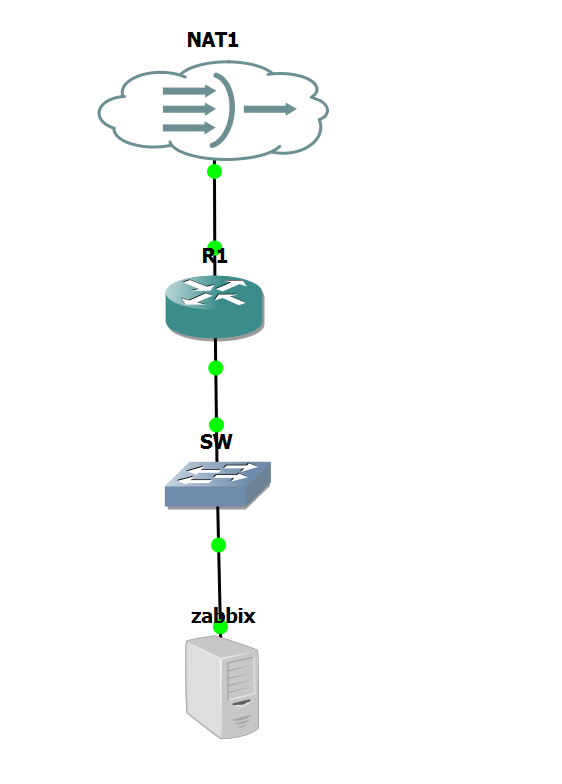

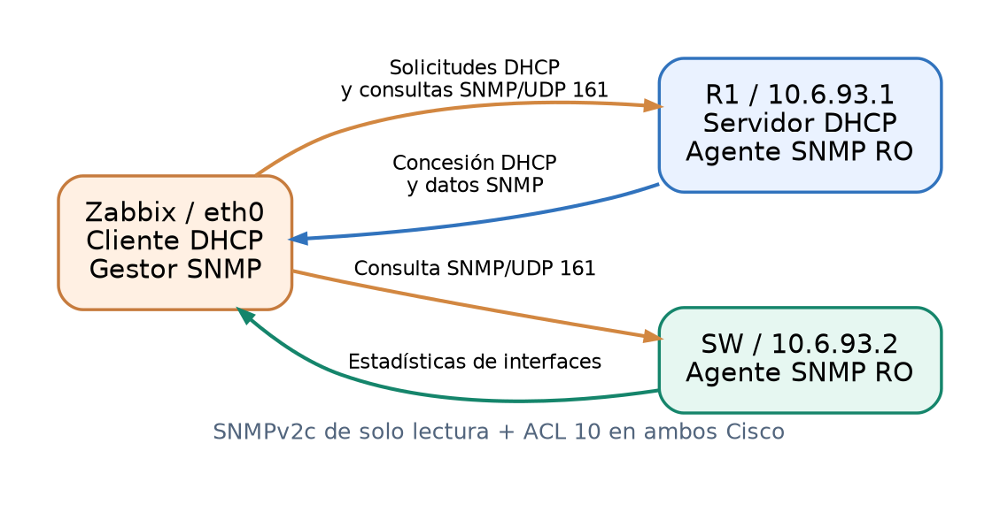

## Evidencias DHCP

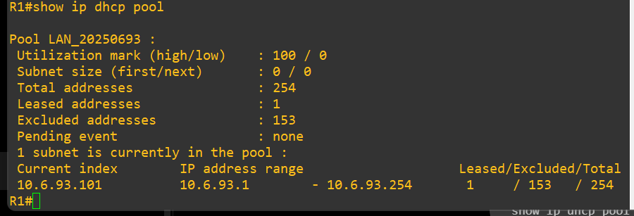

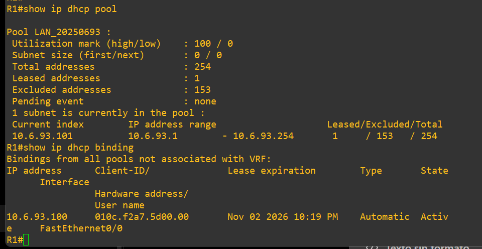

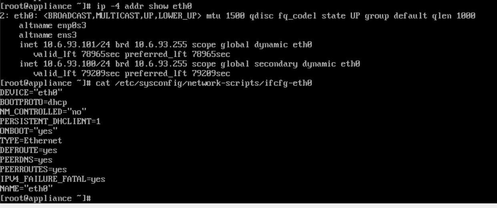

## Conectividad y NAT

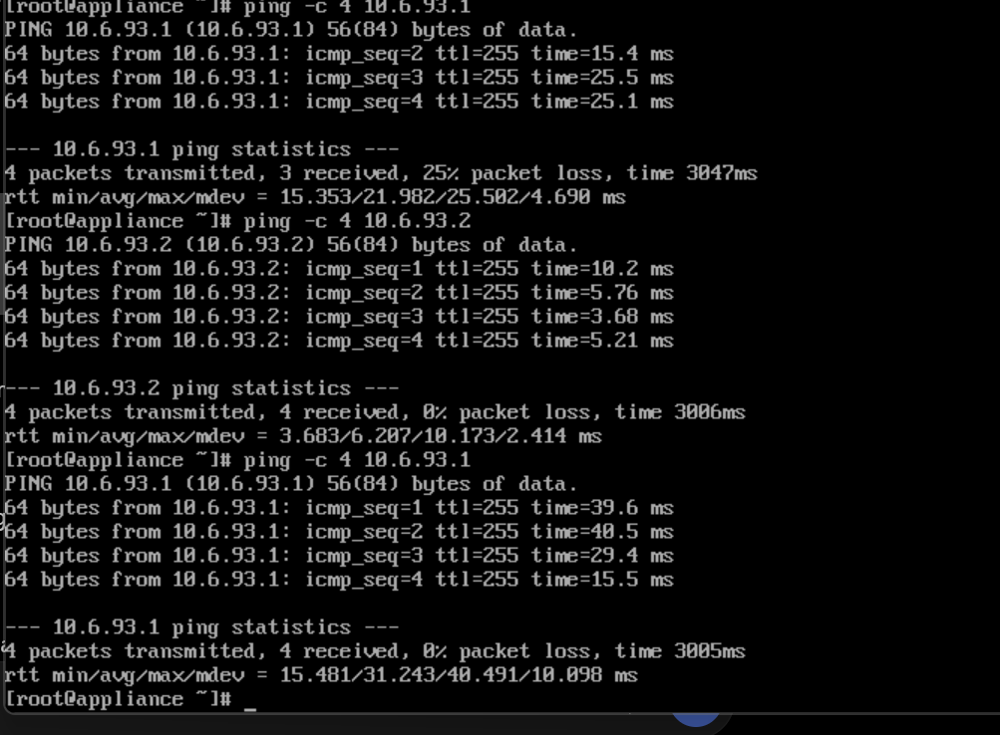

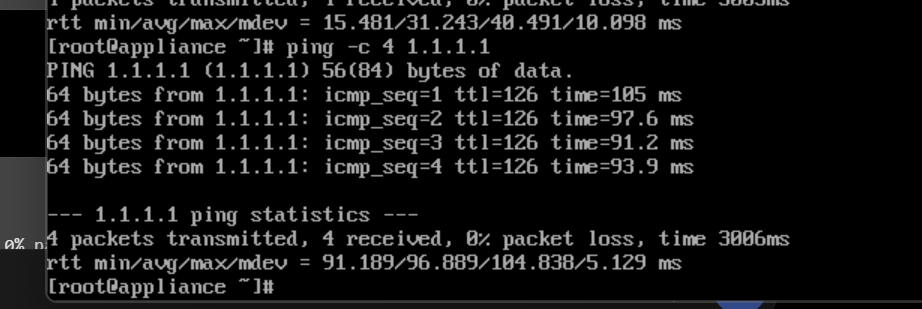

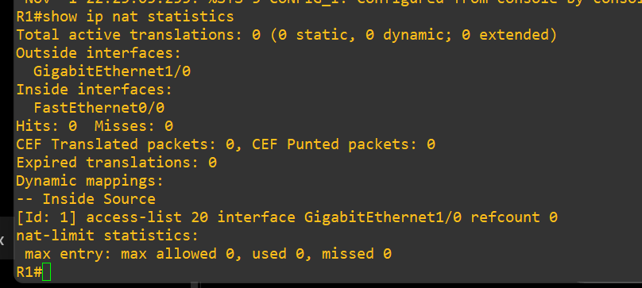

## Monitoreo SNMP de R1 y SW

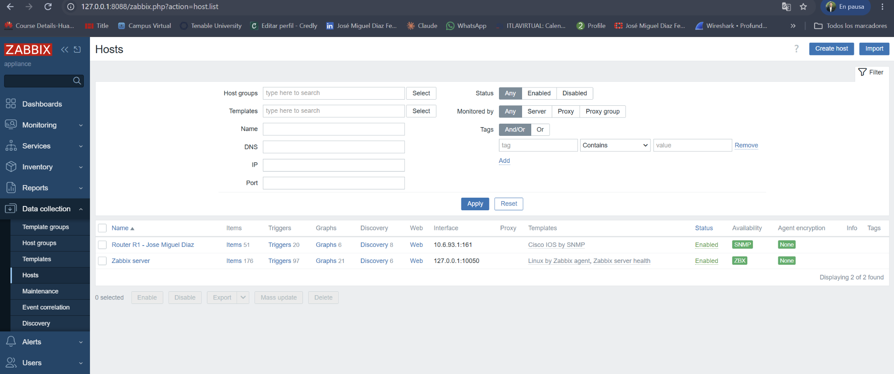

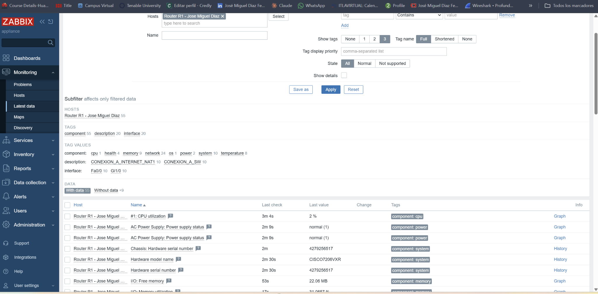

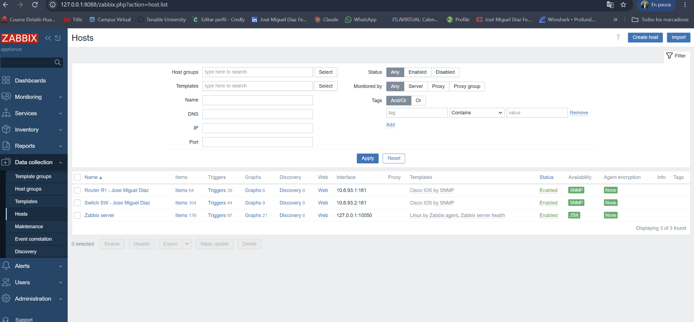

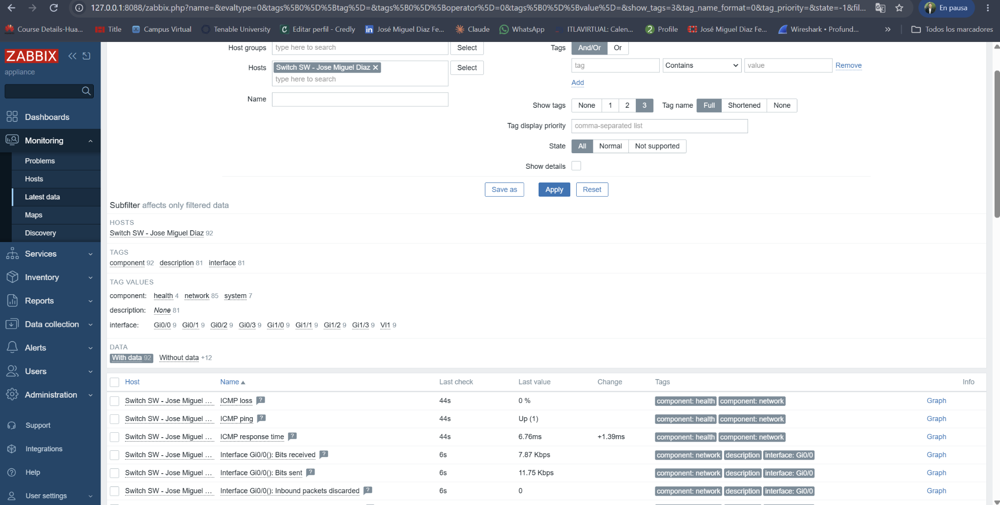

## Acceso administrativo temporal

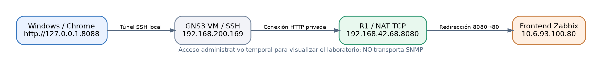

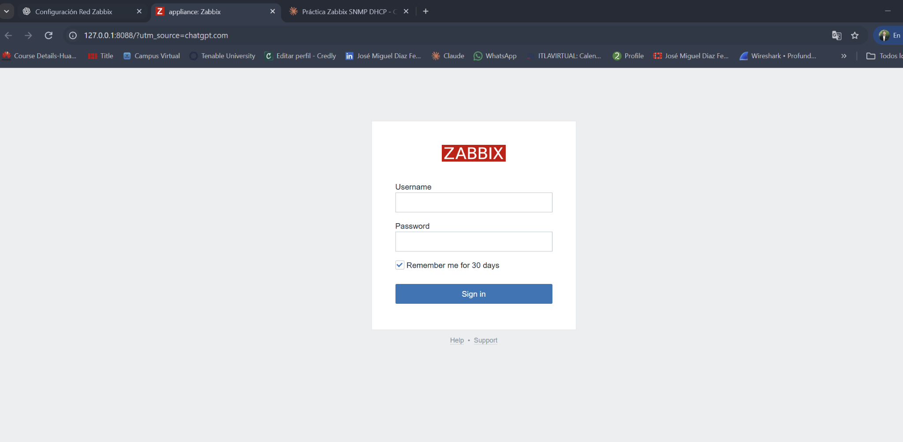

---

**Nota de seguridad:** Las configuraciones Cisco publicadas en `configs/` sustituyen la cadena real de la comunidad SNMP por un marcador. El PDF y el DOCX se incorporan tal como los entregó el estudiante.
