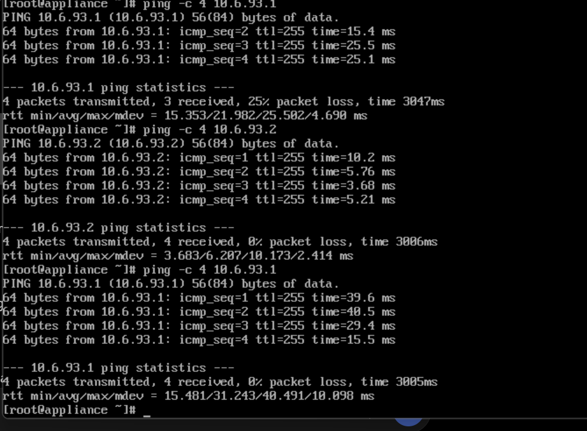
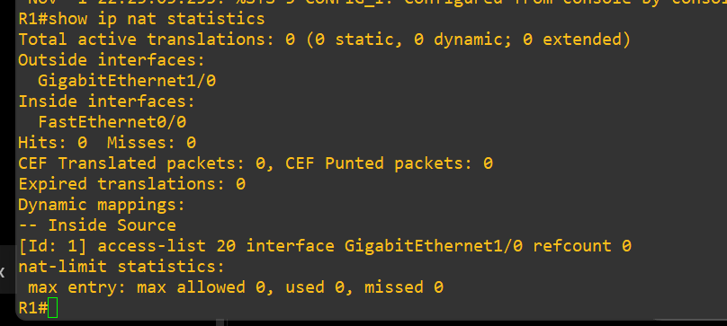
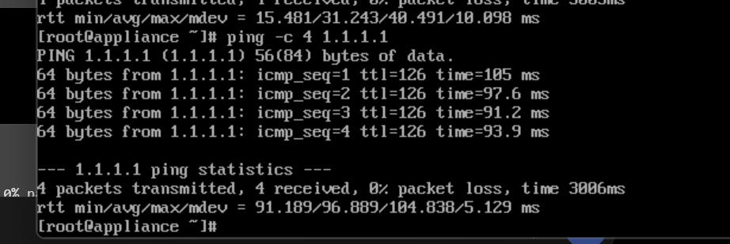
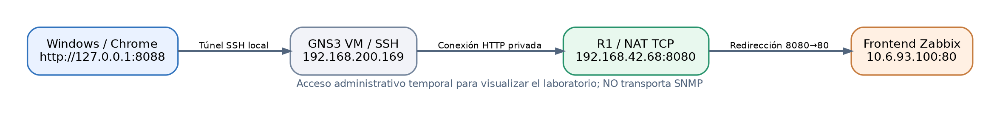
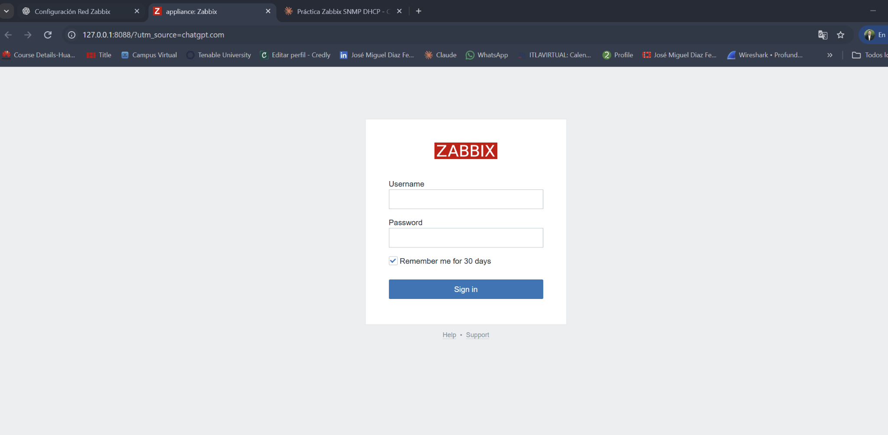
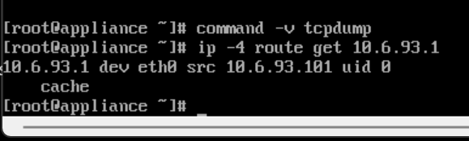
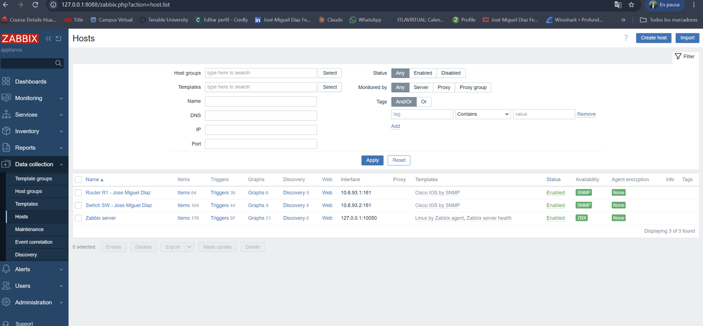
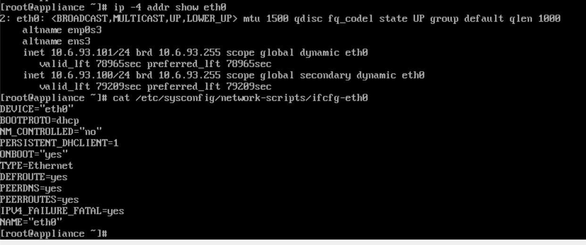

# Incidencias y soluciones aplicadas

El resultado final se consiguió después de varias revisiones. Se registran las incidencias relevantes para explicar el proceso sin atribuir resultados a comandos que no se ejecutaron.

## 1. Fallo de comunicación entre R1 y SW

Los pings inicialmente fallaban y `show ip arp` de R1 mostraba `10.6.93.2 Incomplete`. Se revisaron las conexiones de GNS3 y el estado de los puertos. Finalmente, R1 pudo hacer ping a `10.6.93.2` y el switch pudo hacer ping a `10.6.93.1` con éxito.

## 2. NAT perdido después del reinicio de R1

La LAN quedó operativa, pero en R1 desapareció la configuración NAT. Se restauraron `ip nat inside`, `ip nat outside`, ACL 20 y `overload`; se comprobó conectividad externa desde Zabbix.

## 3. Acceso a Zabbix desde Windows

El navegador Windows no tenía acceso directo a `10.6.93.100` debido al aislamiento de la red virtual. Se aprovechó conectividad SSH hacia GNS3 VM y se configuró una redirección temporal de R1 y un túnel local SSH, obteniendo el frontend en `http://127.0.0.1:8088`.

## 4. La ACL no admitía el origen SNMP elegido

R1 inicialmente mostraba SNMP no disponible porque Zabbix seleccionaba como IP de salida `10.6.93.101`, mientras ACL 10 autorizaba solo `.100`. Tras añadir `.101` a ACL 10, el contador de coincidencias aumentó y las lecturas pasaron a funcionar. Se ajustó también la ACL del switch.

## 5. Dos IP dinámicas en un solo adaptador Zabbix

Zabbix mantuvo `10.6.93.101` como IP principal y `10.6.93.100` como secundaria, ambas dinámicas. El estudiante decidió conservarlas porque el monitoreo y acceso web estaban operativos. **No se corrigió ni eliminó la IP secundaria**, y la documentación no presenta lo contrario.

## 6. Herramienta SNMP externa no instalada

La descarga de `net-snmp-utils` fue lenta en el appliance y no era necesaria para demostrar datos dentro del panel. La prueba definitiva se hizo con los ítems SNMP de Zabbix.

## Recomendaciones para una implementación futura

Simplificar las direcciones IPv4 del servidor; retirar la regla de redirección HTTP si deja de ser necesaria; utilizar un método de administración cifrado; y evaluar SNMPv3 si el contexto deja de ser académico. No se afirma que tales mejoras hayan sido realizadas.
