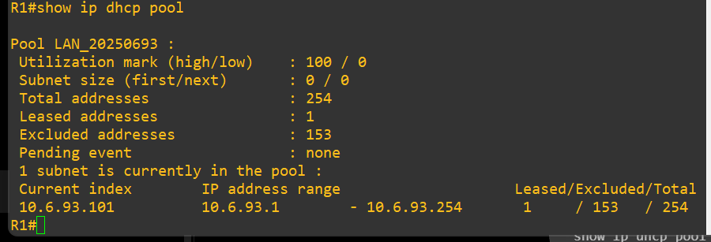
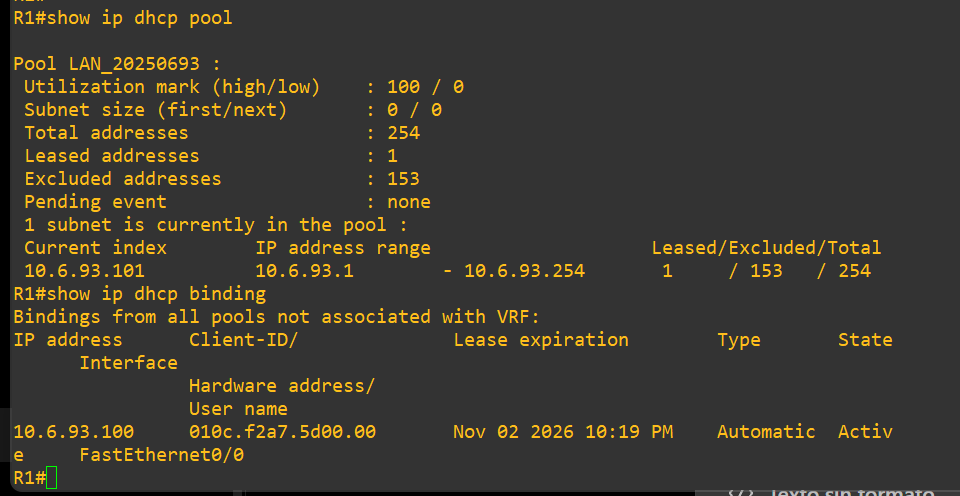
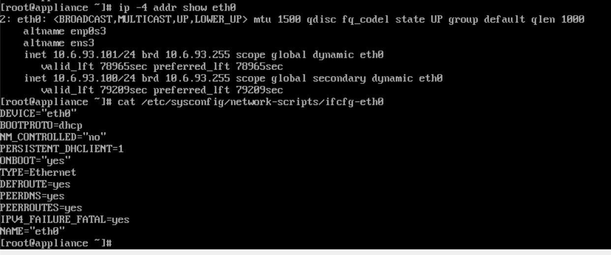
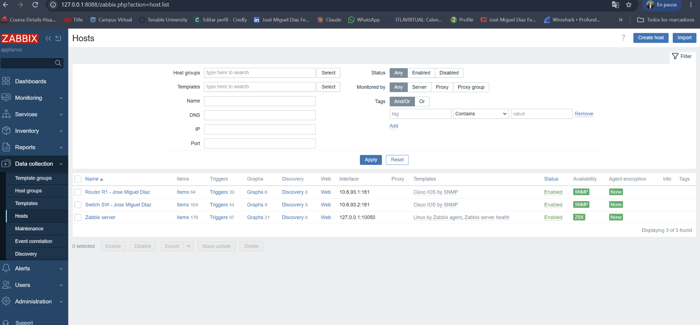
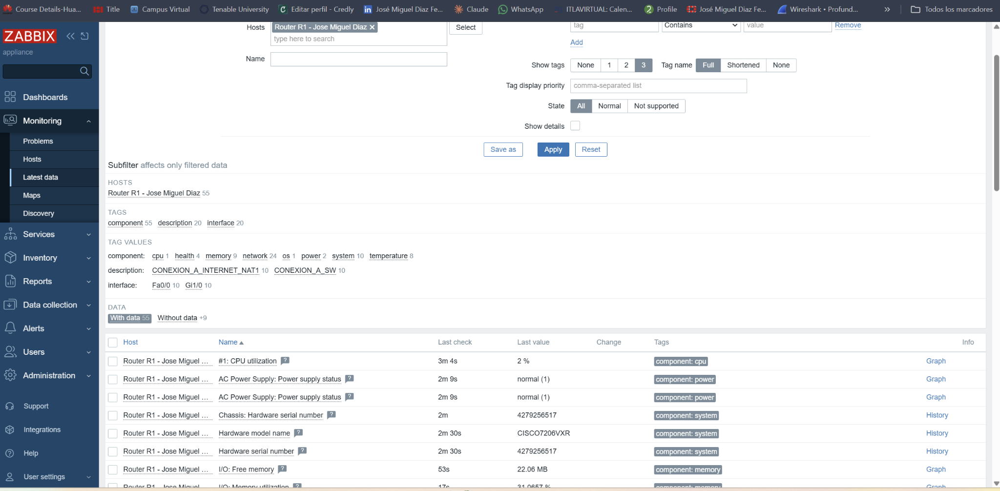
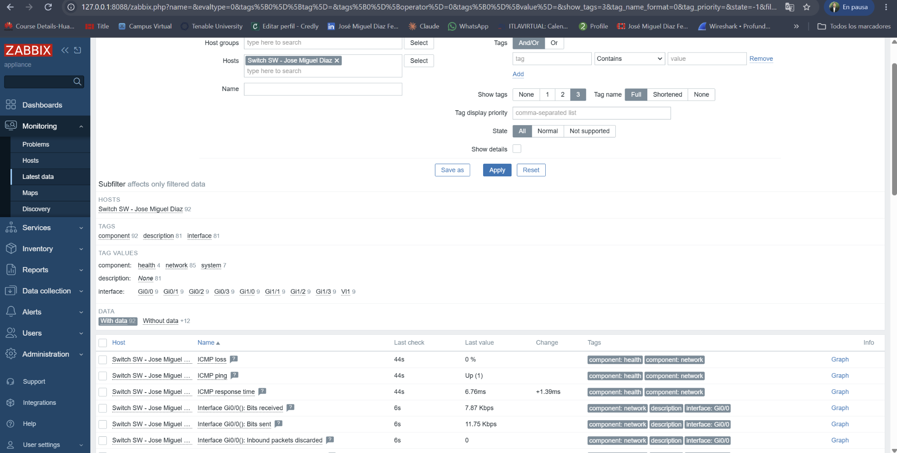

# Pruebas y evidencias del laboratorio

El orden sigue la demostración de red: topología, DHCP, conectividad, disponibilidad del servidor y métricas SNMP. Cada captura procede de la práctica realizada, no de una simulación gráfica. Las tres figuras de `images/diagramas/` son ilustraciones originales generadas a partir de esa topología.

| Nº | Prueba | Archivo y observación |
|---|---|---|
| 01 | Topología final de GNS3 | [Ver imagen](../images/evidencias/01_topologia_real.png) (562 × 784 px) |
| 02 | Pool DHCP en R1 | [Ver imagen](../images/evidencias/02_pool_dhcp_r1.png) (900 × 307 px) |
| 03 | Concesión activa de R1 | [Ver imagen](../images/evidencias/03_concesion_dhcp_r1.png) (960 × 496 px) |
| 04 | Direcciones DHCP y ifcfg-eth0 | [Ver imagen](../images/evidencias/04_cliente_dhcp_zabbix.png) (1242 × 520 px) |
| 05 | Conectividad desde Zabbix a R1/SW | [Ver imagen](../images/evidencias/05_conectividad_lan_zabbix.png) (1003 × 738 px) |
| 06 | Prueba de salida a Internet desde Zabbix | [Ver imagen](../images/evidencias/06_salida_internet_zabbix.png) (922 × 309 px) |
| 07 | NAT/PAT en R1 | [Ver imagen](../images/evidencias/07_nat_r1.png) (808 × 363 px) |
| 08 | Dashboard y versión de Zabbix | [Ver imagen](../images/evidencias/08_inicio_zabbix.png) (2048 × 975 px) |
| 09 | Página de ingreso web de Zabbix vía túnel SSH | [Ver imagen](../images/evidencias/09_acceso_web_tunel.png) (2048 × 1004 px) |
| 10 | Registro del host R1 en Zabbix | [Ver imagen](../images/evidencias/10_registro_r1.png) (2048 × 987 px) |
| 11 | Origen IP de las consultas SNMP | [Ver imagen](../images/evidencias/11_origen_snmp_101.png) (579 × 174 px) |
| 12 | Disponibilidad SNMP de R1 | [Ver imagen](../images/evidencias/12_snmp_r1_verde.png) (2048 × 859 px) |
| 13 | Métricas SNMP de R1 | [Ver imagen](../images/evidencias/13_metricas_snmp_r1.png) (2048 × 1006 px) |
| 14 | Disponibilidad SNMP de R1 y SW | [Ver imagen](../images/evidencias/14_ambos_hosts_snmp_verde.png) (2048 × 952 px) |
| 15 | Métricas SNMP de SW | [Ver imagen](../images/evidencias/15_metricas_snmp_sw.png) (2048 × 1035 px) |

## Resultados que se consideran decisivos

### DHCP y direccionamiento

### Monitoreo SNMP de R1 y SW

Las métricas registradas son muestras puntuales; no representan valores constantes. Los datos ICMP por sí solos **no** prueban SNMP; las pantallas Latest data y el estado SNMP verde sí soportan la conclusión.
